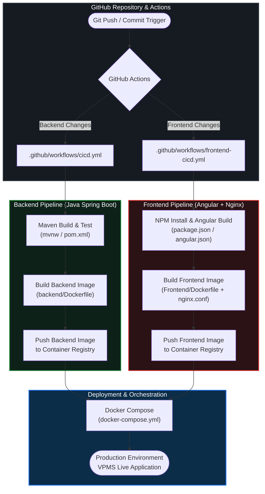

# 🚗 Vehicle Pass Management System (VPMS) — Complete CI/CD Pipeline

A full-stack **Vehicle Pass Management System (VPMS)** built with **Java Spring Boot** and **Angular**, fully containerized with **Docker** and automated via **GitHub Actions** CI/CD workflows.

---

## 🔄 CI/CD Pipeline Architecture

<!-- DRAG AND DROP YOUR GENERATED PNG IMAGE BELOW THIS LINE IN THE GITHUB EDITOR -->

https://drive.google.com/file/d/1-jAvsqcTp8bc4ZkYMm0U_zYEm3xn6TXY/view?usp=drive_link


### Interactive Pipeline Flow (GitHub Native Mermaid Diagram)



---

## 🛠️ Tech Stack

| Layer | Technology |
| :--- | :--- |
| **Frontend** | Angular, TypeScript, HTML5, CSS3, Nginx (Reverse Proxy & Static Server) |
| **Backend** | Java, Spring Boot, Spring Security (JWT Authentication), Maven |
| **Containerization** | Docker (`Dockerfile` for multi-stage builds), Docker Compose |
| **CI/CD Automation** | GitHub Actions (`cicd.yml`, `frontend-cicd.yml`) |

---

## 📂 Project Structure

```text
complete-ci-cd-v1/
├── .github/
│   └── workflows/
│       ├── cicd.yml                 # Backend & Full-Stack CI/CD workflow
│       └── frontend-cicd.yml        # Dedicated Angular Frontend CI/CD workflow
├── Frontend/                        # Angular Frontend Application
│   ├── src/app/                     # Core modules (login, pass-entry, authority, reports, etc.)
│   ├── nginx.conf                   # Custom Nginx routing & proxy configuration
│   ├── Dockerfile                   # Frontend containerization
│   └── package.json                 # Node dependencies & build scripts
├── backend/                         # Spring Boot Backend Application
│   ├── src/main/java/com/heg/       # Controllers, Services, Repositories, JWT Security, DTOs
│   ├── Dockerfile                   # Backend containerization
│   ├── mvnw & mvnw.cmd              # Maven Wrapper scripts
│   └── pom.xml                      # Maven configuration & dependencies
├── docs/
│   └── architecture/                # Detailed system, CI/CD, and runtime documentation
└── docker-compose.yml               # Multi-container orchestration
```

---

## ⚙️ Pipeline Stages Breakdown

### 1. Source & Trigger (`.github/workflows/`)
* **`cicd.yml`**: Triggers on backend repository changes to compile, test, and package the Spring Boot service.
* **`frontend-cicd.yml`**: Triggers on frontend changes to build, bundle, and containerize the Angular application.

### 2. Backend Pipeline (`backend/`)
* **Build & Test**: Uses the Maven Wrapper (`./mvnw`) and `pom.xml` to compile `VpmsApplication.java` and run automated test suites (`VehiclePassManagementSystemApplicationTests.java`).
* **Containerization**: Packages the compiled JAR artifact into a lightweight Docker image via `backend/Dockerfile`.
* **Registry Push**: Pushes the tagged backend image to the container registry.

### 3. Frontend Pipeline (`Frontend/`)
* **Build**: Installs dependencies via `npm` and compiles the Angular project into optimized static production assets.
* **Web Server & Containerization**: Pairs the production build with `Frontend/nginx.conf` inside an Nginx container using `Frontend/Dockerfile`.
* **Registry Push**: Pushes the tagged frontend image to the container registry.

### 4. Orchestration & Deployment (`docker-compose.yml`)
* Pulls the latest Frontend and Backend images and orchestrates the containers, networking, and port bindings in the target environment.

---

## 🚀 Running Locally

### Option 1: Using Docker Compose (Recommended)
Run the entire stack (Frontend + Backend) with a single command from the project root:

```bash
docker-compose up --build -d
```

### Option 2: Manual Local Setup

**1. Start the Backend (Spring Boot):**
```bash
cd backend
./mvnw clean spring-boot:run -DskipTests
```

**2. Start the Frontend (Angular):**
```bash
cd Frontend
npm install
npm start
```

---

## 📚 Architecture Documentation

Detailed technical documentation is available in the [`docs/architecture/`](./docs/architecture/README.md) directory:
* [01 - File Inventory](./docs/architecture/01-file-inventory.md)
* [02 - CI/CD Flow](./docs/architecture/02-cicd-flow.md)
* [03 - Deployment Architecture](./docs/architecture/03-deployment-architecture.md)
* [04 - Runtime Request Flow](./docs/architecture/04-runtime-request-flow.md)
* [05 - Configuration and Ports](./docs/architecture/05-configuration-and-ports.md)
* [06 - Operations and Troubleshooting](./docs/architecture/06-operations-and-troubleshooting.md)
* [07 - Gaps and Improvements](./docs/architecture/07-gaps-and-improvements.md)
* [08 - Interview Explanation](./docs/architecture/08-interview-explanation.md)
