# 02 — CI/CD Pipeline Flow

This document details the GitHub Actions Continuous Integration and Continuous Deployment pipeline configured in [`.github/workflows/cicd.yml`](file:///D:/frontend%20pipeline/VPMS_Frontend/.github/workflows/cicd.yml) and the referenced reusable workflow [`.github/workflows/frontend-cicd.yml`](file:///D:/frontend%20pipeline/VPMS_Frontend/.github/workflows/frontend-cicd.yml).

---

## 1. High-Level Pipeline Architecture

The pipeline runs entirely on a **self-hosted Windows runner** labeled `[self-hosted, Windows]`. The workflow is divided into four sequential jobs:
1. `build-and-test`: Builds the Java 17 backend WAR, skips unit tests, publishes the artifact to Nexus, and uploads `vpms.war` to GitHub workflow storage.
2. `deploy`: Downloads `vpms.war`, checks whether local Apache Tomcat 10.1.28 is listening on port 8090 (starting it via `startup.bat` if stopped), and copies the WAR into `E:\apache-tomcat-10.1.28\webapps`.
3. `docker-deploy`: Downloads `vpms.war`, builds the Docker image `vpms:1.0`, stops and removes any existing `vpms-container`, and launches the backend service using Docker Compose.
4. `frontend`: Invokes `.github/workflows/frontend-cicd.yml`, configures Node.js 24, copies local environment configurations, executes `npm ci` and `ng build`, builds Docker image `vpms-frontend:1.0`, recreates the frontend container, and verifies HTTP 200 availability.

---

## 2. Complete Pipeline Execution Flowchart

```mermaid
flowchart TD
    classDef trigger fill:#e1f5fe,stroke:#0288d1,stroke-width:2px;
    classDef job fill:#f3e5f5,stroke:#7b1fa2,stroke-width:2px;
    classDef step fill:#ffffff,stroke:#455a64,stroke-width:1px;
    classDef decision fill:#fff9c4,stroke:#fbc02d,stroke-width:2px;
    classDef skip fill:#ffebee,stroke:#c62828,stroke-width:2px,stroke-dasharray: 5 5;
    classDef success fill:#e8f5e9,stroke:#2e7d32,stroke-width:2px;

    Dev[Developer Commit / Push]:::trigger --> EventCheck{Git Event Type}:::decision

    EventCheck -- "Pull Request (target: main)" --> PRPath[Run CI Validation Only]
    EventCheck -- "Push (branches: main, backend1, b2, vpmsfinal, v1)" --> PushPath[Run Full CI/CD Pipeline]

    subgraph Job1 ["JOB 1: build-and-test (Runs on: self-hosted, Windows)"]
        direction TB
        J1_Checkout["1. Checkout Source Code<br/><i>actions/checkout@v4</i>"]:::step
        J1_Maven["2. Maven Build & Deploy<br/><code>mvn clean deploy -DskipTests</code><br/><i>Distribution: Nexus Snapshot Repository</i>"]:::step
        J1_TestNote["Unit Tests: EXPLICITLY SKIPPED<br/><code>-DskipTests flag active</code>"]:::skip
        J1_Artifact["3. Upload WAR Artifact<br/><i>actions/upload-artifact@v4 (name: vpms-war)</i>"]:::step

        J1_Checkout --> J1_Maven
        J1_Maven -.-> J1_TestNote
        J1_Maven --> J1_Artifact
    end

    PRPath --> Job1
    PushPath --> Job1

    Job1 --> PR_Gate{Event == push?}:::decision
    PR_Gate -- "No (Pull Request)" --> PR_End["Stop: Deployments Skipped on PR"]:::skip
    PR_Gate -- "Yes (Push Event)" --> Job2

    subgraph Job2 ["JOB 2: deploy (Tomcat Deployment)"]
        direction TB
        J2_Download["1. Download WAR Artifact<br/><i>actions/download-artifact@v4 (deploy-artifact)</i>"]:::step
        J2_CheckPort{"2. Is Port 8090 listening?<br/><code>Get-NetTCPConnection -LocalPort 8090</code>"}:::decision
        J2_StartTomcat["Execute Tomcat Startup<br/><code>cmd.exe /c start /b startup.bat</code><br/><i>Wait up to 45s for listener</i>"]:::step
        J2_CopyWar["3. Copy WAR to webapps<br/><code>Copy-Item vpms.war E:\\apache-tomcat-10.1.28\\webapps</code>"]:::step

        J2_Download --> J2_CheckPort
        J2_CheckPort -- "No Listener" --> J2_StartTomcat --> J2_CopyWar
        J2_CheckPort -- "Already Running" --> J2_CopyWar
    end

    Job2 --> Job3

    subgraph Job3 ["JOB 3: docker-deploy (Backend Container)"]
        direction TB
        J3_Checkout["1. Checkout Code<br/><i>actions/checkout@v4</i>"]:::step
        J3_Download["2. Download WAR Artifact<br/><i>actions/download-artifact@v4 (docker-artifact)</i>"]:::step
        J3_Prep["3. Move WAR to target/<br/><code>Copy-Item docker-artifact/vpms.war backend/target/</code>"]:::step
        J3_DockerCheck["4. Check Docker Daemon<br/><code>docker.exe version, info, context</code>"]:::step
        J3_Build["5. Build Backend Image<br/><code>docker build -t vpms:1.0 .</code>"]:::step
        J3_RemoveOld["6. Remove Old Container<br/><code>docker rm --force vpms-container</code><br/><i>⚠️ Brief Service Interruption</i>"]:::step
        J3_Compose["7. Deploy with Compose<br/><code>docker compose -p vpms up -d --no-deps --force-recreate backend</code>"]:::step
        J3_Verify["8. Verify Container State<br/><code>docker inspect Status == 'running'</code><br/><i>Fetch tail 100 logs</i>"]:::step

        J3_Checkout --> J3_Download --> J3_Prep --> J3_DockerCheck --> J3_Build --> J3_RemoveOld --> J3_Compose --> J3_Verify
    end

    Job3 --> Job4

    subgraph Job4 ["JOB 4: frontend (Reusable Workflow: frontend-cicd.yml)"]
        direction TB
        J4_Checkout["1. Checkout Code<br/><i>actions/checkout@v4</i>"]:::step
        J4_Node["2. Set up Node.js 24<br/><i>actions/setup-node@v4 (version: 24)</i>"]:::step
        J4_EnvCopy["3. Inject Local Environment<br/><code>Copy D:\\...\\environment.ts to workspace</code>"]:::step
        J4_NpmCi["4. Install Dependencies<br/><code>npm.cmd ci</code>"]:::step
        J4_NgBuild["5. Build Angular Production<br/><code>ng build --configuration=production --base-href=/vpms-ui/</code>"]:::step
        J4_DockerBuild["6. Build Frontend Image<br/><code>docker build -t vpms-frontend:1.0 .</code>"]:::step
        J4_RemoveOld["7. Remove Old Container<br/><code>docker rm -f vpms-frontend</code>"]:::step
        J4_Compose["8. Deploy Frontend Compose<br/><code>docker compose -p vpms up -d --no-deps --force-recreate frontend</code>"]:::step
        J4_Verify["9. Verify Frontend Endpoint<br/><code>Invoke-WebRequest http://127.0.0.1:4200/vpms-ui/</code><br/><i>Max 10 attempts (every 2s)</i>"]:::step

        J4_Checkout --> J4_Node --> J4_EnvCopy --> J4_NpmCi --> J4_NgBuild --> J4_DockerBuild --> J4_RemoveOld --> J4_Compose --> J4_Verify
    end

    J4_Verify --> PipelineSuccess([Pipeline Completed Successfully]):::success
```



---

## 3. Triggers, Branch Filters, and Conditionals

### A. Event Triggers ([`cicd.yml#L16-L23`](file:///D:/frontend%20pipeline/VPMS_Frontend/.github/workflows/cicd.yml#L16-L23))
- **`push`**: Executes whenever commits are pushed to any of these 5 branches: `main`, `backend1`, `b2`, `vpmsfinal`, `v1`.
- **`pull_request`**: Executes whenever a Pull Request targets the `main` branch.

### B. Pull Request vs. Push Behavior
- **Pull Request**: Executes **Job 1 (`build-and-test`) only**. Jobs 2, 3, and 4 each declare `if: github.event_name == 'push'`, meaning they are automatically skipped for pull requests. PR builds validate compile integrity and upload to Nexus, but do not touch local Tomcat or Docker runtimes.
- **Push Event**: Executes all four jobs sequentially via strict `needs` dependencies.

### C. Concurrency Guard ([`frontend-cicd.yml#L41-L43`](file:///D:/frontend%20pipeline/VPMS_Frontend/.github/workflows/frontend-cicd.yml#L41-L43))
- The frontend job defines:
  ```yaml
  concurrency:
    group: vpms-frontend-deployment
    cancel-in-progress: false
  ```
  This ensures that rapid successive pushes do not cause conflicting npm builds or simultaneous Docker Compose operations on port 4200.

---

## 4. Stage-by-Stage Technical Walkthrough

### Step 1: Maven Build, Nexus Publishing, and Test Status
* **Location**: [`.github/workflows/cicd.yml#L88-L101`](file:///D:/frontend%20pipeline/VPMS_Frontend/.github/workflows/cicd.yml#L88-L101)
* **Working Directory**: `backend`
* **Execution Command**:
  ```powershell
  $env:PATH = "$env:JAVA_HOME\bin;$env:PATH"
  & $env:MAVEN_BIN -s $env:SETTINGS_XML clean deploy -DskipTests --no-transfer-progress
  ```
* **Test Execution Audit**: **TESTS DO NOT RUN**. The command explicitly includes `-DskipTests`. The unit test in [`VehiclePassManagementSystemApplicationTests.java`](file:///D:/frontend%20pipeline/VPMS_Frontend/backend/src/test/java/com/heg/VehiclePassManagementSystemApplicationTests.java#L6-L13) is never executed during CI.
* **Nexus Distribution**: The Maven `deploy` phase reads `<distributionManagement>` in [`pom.xml#L115-L127`](file:///D:/frontend%20pipeline/VPMS_Frontend/backend/pom.xml#L115-L127). Because version is `0.0.1-SNAPSHOT`, the WAR is published to `http://localhost:8081/repository/maven-snapshots/` authenticated via credentials in `C:\maven\settings.xml`.
* **Artifact Generation**: The output `backend/target/vpms.war` is archived as GitHub Actions artifact `vpms-war` via `actions/upload-artifact@v4`.

### Step 2: Local Apache Tomcat Deployment
* **Location**: [`.github/workflows/cicd.yml#L116-L223`](file:///D:/frontend%20pipeline/VPMS_Frontend/.github/workflows/cicd.yml#L116-L223)
* **Dependency**: `needs: build-and-test`
* **Artifact Ingestion**: Downloads `vpms-war` into `./deploy-artifact/`.
* **Tomcat Process Check**: Uses PowerShell `Get-NetTCPConnection -LocalPort 8090 -State Listen`. If no process is listening on 8090, it launches `E:\apache-tomcat-10.1.28\bin\startup.bat` using a detached process (`cmd.exe /c start "" /b startup.bat`) and removes `RUNNER_TRACKING_ID` so the GitHub Actions runner agent does not terminate the Tomcat process when the job finishes.
* **WAR Copy**: Copies `deploy-artifact/vpms.war` into `E:\apache-tomcat-10.1.28\webapps\`. Tomcat automatically explodes and deploys it under context path `/vpms`.

### Step 3: Backend Docker Container Deployment
* **Location**: [`.github/workflows/cicd.yml#L230-L426`](file:///D:/frontend%20pipeline/VPMS_Frontend/.github/workflows/cicd.yml#L230-L426)
* **Dependencies**: `needs: [build-and-test, deploy]`
* **Artifact Preparation**: Downloads `vpms-war` into `docker-artifact/` and copies it into `backend/target/vpms.war` to satisfy `backend/Dockerfile` (`COPY target/vpms.war vpms.war`).
* **Docker Build**: Executes `& $env:DOCKER_BIN build --progress=plain -t vpms:1.0 .` inside `backend/`.
* **Container Lifecycle**:
  - Checks if a container named `vpms-container` exists via `docker ps -a --filter "name=^vpms-container$"`.
  - If present, executes `docker rm --force vpms-container`.
  - Executes Compose deployment:
    ```powershell
    & $env:DOCKER_BIN compose -p vpms -f docker-compose.yml up -d --no-deps --force-recreate backend
    ```
* **Readiness Verification**:
  - Waits 10 seconds (`Start-Sleep -Seconds 10`).
  - Checks `docker inspect --format "{{.State.Status}}" vpms-container`.
  - Verifies the status equals `"running"`.
  - Dumps the last 100 log lines via `docker logs --tail 100 vpms-container`.

### Step 4: Reusable Frontend Build and Deployment
* **Location**: [`.github/workflows/frontend-cicd.yml#L37-L166`](file:///D:/frontend%20pipeline/VPMS_Frontend/.github/workflows/frontend-cicd.yml#L37-L166)
* **Caller**: Invoked by `frontend` job in `cicd.yml#L430-L435` via `uses: ./.github/workflows/frontend-cicd.yml`.
* **Node Selection**: Uses `actions/setup-node@v4` with `node-version: "24"`. If Node 24 is already cached on the runner host, it binds to it; otherwise it fetches it.
* **Environment File Preparation**: Because `Frontend/src/environments/environment.ts` is gitignored, the workflow copies the existing host file:
  ```powershell
  $source = 'D:\frontend pipeline\VPMS_Frontend\Frontend\src\environments\environment.ts'
  $destination = Join-Path $env:GITHUB_WORKSPACE 'Frontend\src\environments\environment.ts'
  Copy-Item -LiteralPath $source -Destination $destination -Force
  ```
* **Dependency & Build Execution**:
  - Runs `npm.cmd ci` inside `Frontend/`.
  - Runs `npm.cmd run build -- --configuration=production --output-path=dist/vpms-ui --base-href=/vpms-ui/`.
  - Confirms output file `dist/vpms-ui/browser/index.html` exists.
* **Docker Image Creation**: Builds `vpms-frontend:1.0` using `Frontend/Dockerfile` (`COPY dist/vpms-ui/browser/ /usr/share/nginx/html/vpms-ui/` and `COPY nginx.conf /etc/nginx/conf.d/default.conf`).
* **Container Lifecycle**:
  - Removes old container: `docker rm -f vpms-frontend`.
  - Starts container via Compose:
    ```powershell
    & $env:DOCKER_BIN compose -p vpms -f docker-compose.yml up -d --no-deps --force-recreate frontend
    ```
* **Readiness Verification**:
  - Polls `http://127.0.0.1:4200/vpms-ui/` using `Invoke-WebRequest -UseBasicParsing -TimeoutSec 5` up to 10 attempts (with 2-second sleep).
  - Verifies HTTP status code is `200`.

---

## 5. Deployment Failure Scenarios & Downtime Analysis

### A. Failure Impact Matrix
| Failing Stage | State of External Tomcat | State of Docker Backend | State of Docker Frontend |
| :--- | :--- | :--- | :--- |
| **`build-and-test` fails** | Untouched (previous version stays running). | Untouched (previous version stays running). | Untouched (previous version stays running). |
| **`deploy` (Tomcat) fails** | May be partially overwritten or stopped. | Untouched (previous version stays running). | Untouched (previous version stays running). |
| **`docker-deploy` fails** | **Updated and running new WAR**. | **Stopped or degraded**. Container was removed by `docker rm` and may have failed during Compose `up` or startup check. | Untouched (previous version stays running). |
| **`frontend` fails** | **Updated and running new WAR**. | **Updated and running new WAR**. | **Stopped or degraded**. Old frontend removed, new container failed build/verify. |

### B. Deployment Interruption ("Stop-Before-Start" Downtime)
In both `docker-deploy` and `frontend` jobs, the pipeline explicitly deletes the running container before starting the new one:
1. `docker rm --force vpms-container`
2. `docker compose ... up -d --force-recreate backend`

This architecture creates an **unavoidable deployment downtime window** (between 10 and 30 seconds) during which requests to port 8092 or port 4200 will receive connection refused errors. True zero-downtime rolling deployments (e.g., blue-green or health-checked proxy routing) are not configured.
