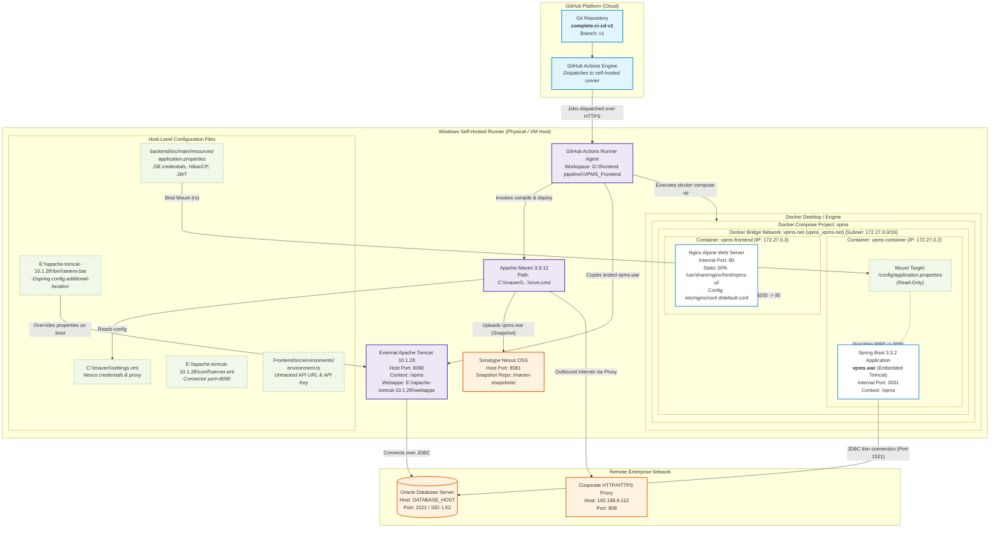

# 03 — Deployment Architecture & Topology

This document details the deployment infrastructure, container definitions, network boundaries, and host integrations for the **VPMS** system based on [`.github/workflows/cicd.yml`](file:///D:/frontend%20pipeline/VPMS_Frontend/.github/workflows/cicd.yml), [`.github/workflows/frontend-cicd.yml`](file:///D:/frontend%20pipeline/VPMS_Frontend/.github/workflows/frontend-cicd.yml), and [`docker-compose.yml`](file:///D:/frontend%20pipeline/VPMS_Frontend/docker-compose.yml).

---

## 1. Architectural Boundaries Overview

The VPMS deployment spans several physical and logical boundaries:
1. **GitHub Cloud**: Hosts the Git repository and coordinates workflow runs.
2. **Windows Host Machine (Self-Hosted Runner)**: An on-premise Windows workstation running the GitHub Actions runner agent, local Apache Maven, local Apache Tomcat 10.1.28, Nexus repository, and Docker Desktop.
3. **Docker Engine / Compose Subsystem**: Manages the bridge network (`vpms-net`), image builds, container lifecycle, and host port forwarding.
4. **Corporate Network / Remote Infrastructure**: Houses the enterprise Oracle Database and the corporate HTTP/HTTPS proxy.

---

## 2. Comprehensive Deployment Architecture Diagram

---

## 3. Network Architecture & Published Ports

| Component | Nature | Host Port | Container / Internal Port | Protocol | Network Scope | Purpose / Route |
| :--- | :--- | :--- | :--- | :--- | :--- | :--- |
| **Frontend Container (`vpms-frontend`)** | Docker Container | `4200` | `80` | HTTP | Host / External | Serves static compiled Angular 21 SPA assets via Nginx. |
| **Backend Container (`vpms-container`)** | Docker Container | `8092` | `3031` | HTTP | Host / External | Spring Boot embedded Tomcat serving `/vpms/api/*` REST endpoints. |
| **External Tomcat** | Host Process | `8090` | N/A | HTTP | Host / External | Standalone Apache Tomcat 10.1.28 hosting `/vpms` WAR deployment. |
| **Nexus Repository** | Host / Local Service | `8081` | N/A | HTTP | Host / Localhost | Maven snapshot and release repository receiving `clean deploy` artifacts. |
| **Oracle Database** | Remote Host | `1521` | N/A | Oracle TNS/TCP | Enterprise Intranet | Stores user credentials, authorities, pass records, and history. |
| **Corporate Proxy** | Remote Host | `808` | N/A | HTTP | Enterprise Intranet | Outbound corporate proxy (`192.168.9.112:808`) for internet access. |

---

## 4. Container & Service Specifications

### A. Backend Service (`backend`)
* **Compose Service Name**: `backend` ([`docker-compose.yml#L10`](file:///D:/frontend%20pipeline/VPMS_Frontend/docker-compose.yml#L10))
* **Container Name**: `vpms-container` ([`docker-compose.yml#L12`](file:///D:/frontend%20pipeline/VPMS_Frontend/docker-compose.yml#L12))
* **Image Name & Tag**: `vpms:1.0` ([`docker-compose.yml#L11`](file:///D:/frontend%20pipeline/VPMS_Frontend/docker-compose.yml#L11))
* **Base Image**: `eclipse-temurin:17-jdk-alpine` ([`backend/Dockerfile#L1`](file:///D:/frontend%20pipeline/VPMS_Frontend/backend/Dockerfile#L1))
* **Exposed Internal Port**: `3031`
* **Host Port Forwarding**: `8092:3031`
* **Network Membership**: Attached to `vpms-net` (resolves as `vpms_vpms-net` in Docker Engine, observed IP `172.27.0.2`).
* **Bind Mount**:
  - **Host Path**: `D:/frontend pipeline/VPMS_Frontend/backend/src/main/resources/application.properties`
  - **Container Target**: `/config/application.properties`
  - **Permissions**: Read-only (`:ro`)
* **Environment Variable**: `SPRING_CONFIG_ADDITIONAL_LOCATION: file:/config/application.properties`
* **Entrypoint**: `["java", "-jar", "vpms.war"]`

### B. Frontend Service (`frontend`)
* **Compose Service Name**: `frontend` ([`docker-compose.yml#L2`](file:///D:/frontend%20pipeline/VPMS_Frontend/docker-compose.yml#L2))
* **Container Name**: `vpms-frontend` ([`docker-compose.yml#L4`](file:///D:/frontend%20pipeline/VPMS_Frontend/docker-compose.yml#L4))
* **Image Name & Tag**: `vpms-frontend:1.0` ([`docker-compose.yml#L3`](file:///D:/frontend%20pipeline/VPMS_Frontend/docker-compose.yml#L3))
* **Base Image**: `nginx:stable-alpine` ([`Frontend/Dockerfile#L1`](file:///D:/frontend%20pipeline/VPMS_Frontend/Frontend/Dockerfile#L1))
* **Exposed Internal Port**: `80`
* **Host Port Forwarding**: `4200:80`
* **Network Membership**: Attached to `vpms-net` (observed IP `172.27.0.3`).
* **Volume Mounts**: **None**. Compiled SPA assets and `nginx.conf` are baked directly into the Docker image during build.
* **Command**: `["nginx", "-g", "daemon off;"]`

---

## 5. Architectural Communication Table

| Source | Destination | Transport / Protocol | Port | Configuration / Source Evidence | Description & Operational Purpose |
| :--- | :--- | :--- | :--- | :--- | :--- |
| **GitHub Actions Runner** | **Nexus OSS** | HTTP | `8081` | `pom.xml#L119`, `C:\maven\settings.xml` | `mvn deploy` transmits compiled snapshot WAR to local Nexus repository. |
| **GitHub Actions Runner** | **Tomcat Webapps** | Windows Filesystem Copy | N/A | `cicd.yml#L219` | Deploys WAR directly to `E:\apache-tomcat-10.1.28\webapps\vpms.war`. |
| **External Tomcat** | **Oracle DB** | JDBC (Thin Driver) | `1521` | `application.properties#L18` | Tomcat instance queries Oracle database using HikariCP. |
| **Host Port 8092** | **Backend Container (3031)** | Docker NAT Forwarding | `8092 -> 3031` | `docker-compose.yml#L14` | Docker proxy routes inbound host port 8092 traffic to Spring Boot port 3031. |
| **Host Port 4200** | **Frontend Container (80)** | Docker NAT Forwarding | `4200 -> 80` | `docker-compose.yml#L6` | Docker proxy routes inbound host port 4200 traffic to Nginx port 80. |
| **Spring Boot Container** | **Oracle DB** | JDBC (Thin Driver) | `1521` | `application.properties#L18` | Containerized Spring Boot connects directly to remote Oracle Database on enterprise network. |
| **Frontend Container** | **Backend Container** | **NO DIRECT TRAFFIC** | N/A | `Frontend/nginx.conf` | **Important**: The frontend Nginx container does NOT proxy requests to the backend container. All API traffic travels directly from client browsers to the published backend URL. |

---

## 6. Build-Time vs. Runtime Configuration Boundaries

A common point of operational confusion in full-stack container pipelines is distinguishing between **build-time baking** and **runtime injection**:

1. **Angular Frontend (`Frontend/`) — STRICTLY BUILD-TIME**:
   - Angular is a client-side Single Page Application.
   - When `npm run build` runs, values from `environment.ts` (`apiBaseUrl`, `apiKey`) are **permanently compiled into JavaScript bundles** in `dist/vpms-ui/browser/`.
   - Modifying `environment.ts` on the host after the Docker build has **zero effect** on running containers. Updating the API URL requires a full `ng build` and `docker build`.
2. **Spring Boot Backend (`backend/`) — DUAL RUNTIME OVERRIDE**:
   - The compiled WAR has a default `application.properties` embedded inside `WEB-INF/classes/application.properties`.
   - However, `docker-compose.yml` mounts the host's `application.properties` to `/config/application.properties` and sets `SPRING_CONFIG_ADDITIONAL_LOCATION: file:/config/application.properties`.
   - As a result, updating `application.properties` on the host and restarting the container (`docker compose restart backend`) takes effect immediately without recompiling the WAR or rebuilding the Docker image.
