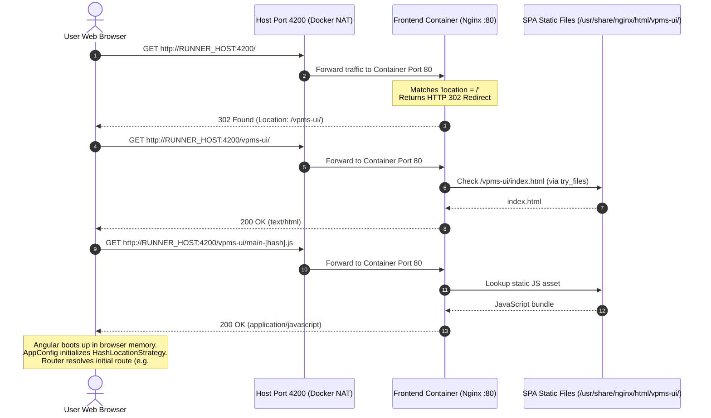
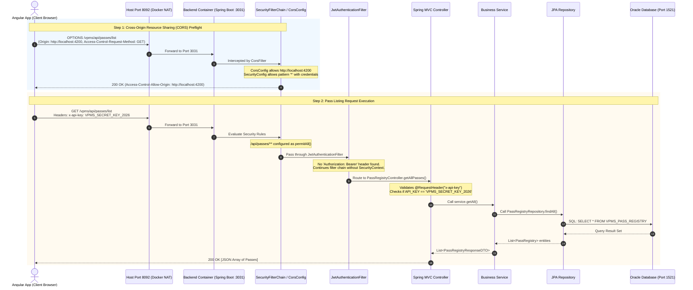

# 04 — Runtime Information & Request Flow

This document details the runtime information flow of the **VPMS** system, covering how client web browsers load the Angular Single Page Application (SPA), how API requests are generated, CORS handling, authentication filtering, and database persistence.

---

## 1. Architectural Routing Discovery: Direct Browser-to-Backend

A crucial architectural finding confirmed from [`Frontend/nginx.conf`](file:///D:/frontend%20pipeline/VPMS_Frontend/Frontend/nginx.conf#L1-L23) is:

> **Nginx is configured purely as a static web server and does NOT act as a reverse proxy for backend APIs.**

The Nginx configuration contains no `proxy_pass` directive. Therefore:
* The user's browser fetches HTML, JS, and CSS files from the frontend Nginx container (Host Port `4200`).
* Once loaded in the browser, the Angular application initiates asynchronous HTTP calls **directly from the client browser to the published backend URL** (Host Port `8092` or `9092`).
* **The Docker bridge network (`vpms-net`) is NOT used for frontend-to-backend communication.** The browser cannot resolve Docker internal service names (like `http://backend:3031`), so all calls must route through the host machine's published IP and port.

---

## 2. Diagram A: Loading the Frontend Application

---

## 3. Diagram B: Runtime API Request & Authentication Flow

This diagram illustrates a real API call cycle based on the implemented security configuration in [`SecurityConfig.java`](file:///D:/frontend%20pipeline/VPMS_Frontend/backend/src/main/java/com/heg/config/SecurityConfig.java), [`AuthController.java`](file:///D:/frontend%20pipeline/VPMS_Frontend/backend/src/main/java/com/heg/controller/AuthController.java), and [`PassRegistryController.java`](file:///D:/frontend%20pipeline/VPMS_Frontend/backend/src/main/java/com/heg/controller/PassRegistryController.java).

---

## 4. End-to-End Authentication & Session Management

### A. Authentication Sequence (Login)
1. **User Submission**: The user enters an Employee Code and Password in the Angular login component ([`login.ts`](file:///D:/frontend%20pipeline/VPMS_Frontend/Frontend/src/app/login/login.ts#L53-L102)).
2. **Endpoint Dispatch**: [`AuthService.ts#L82`](file:///D:/frontend%20pipeline/VPMS_Frontend/Frontend/src/app/core/auth.service.ts#L82) issues an HTTP POST with payload `{ username, password }` and header `x-api-key`.
3. **Backend Processing**:
   - In [`AuthController.java#L58-L65`](file:///D:/frontend%20pipeline/VPMS_Frontend/backend/src/main/java/com/heg/controller/AuthController.java#L58-L65), `AuthenticationManager.authenticate(...)` validates the credentials against [`CustomUserDetailsService.java`](file:///D:/frontend%20pipeline/VPMS_Frontend/backend/src/main/java/com/heg/service/CustomUserDetailsService.java).
   - `CustomUserDetailsService` queries the `VPMS_AUTHORITY` table in Oracle via [`AppUserRepository.java`](file:///D:/frontend%20pipeline/VPMS_Frontend/backend/src/main/java/com/heg/repository/AppUserRepository.java) to load hashed password and roles.
   - Upon successful verification, [`JwtService.java`](file:///D:/frontend%20pipeline/VPMS_Frontend/backend/src/main/java/com/heg/security/JwtService.java) creates a signed JWT token containing the username and claims with an expiration of 24 hours (`86,400,000 ms`).
   - The controller returns a `LoginResponse(token, username, role)`.

### B. Client-Side Session Storage & Dual-Security Pattern
* **Storage Location**: Session details are saved in the browser's `sessionStorage` under the key `'vpsm_session'` ([`AuthService.ts#L42`](file:///D:/frontend%20pipeline/VPMS_Frontend/Frontend/src/app/core/auth.service.ts#L42)).
* **Dual Security Pattern Observed**:
  - While Spring Boot includes a complete JWT generation and filtering infrastructure (`JwtAuthenticationFilter`), the Angular frontend services ([`auth.service.ts`](file:///D:/frontend%20pipeline/VPMS_Frontend/Frontend/src/app/core/auth.service.ts#L47-L51), [`pass.service.ts`](file:///D:/frontend%20pipeline/VPMS_Frontend/Frontend/src/app/services/pass.service.ts)) do not append the returned JWT `Bearer <token>` to outbound pass requests.
  - Instead, the frontend relies on a static header `'x-api-key': 'VPMS_SECRET_KEY_2026'`, which [`PassRegistryController.java#L85`](file:///D:/frontend%20pipeline/VPMS_Frontend/backend/src/main/java/com/heg/controller/PassRegistryController.java#L85) manually validates because `/api/passes/**` is marked `permitAll()` in [`SecurityConfig.java#L92`](file:///D:/frontend%20pipeline/VPMS_Frontend/backend/src/main/java/com/heg/config/SecurityConfig.java#L92).

---

## 5. Network Traffic Summary: Docker Bridge vs. Host Loopback

| Communication Path | Traverses Docker Network (`vpms-net`)? | Traverses Host NAT / Loopback? | Protocol & Destination |
| :--- | :--- | :--- | :--- |
| **Browser -> Nginx (Initial Load)** | **No** (Direct connection from browser to host IP) | **Yes** (Host Port 4200 -> Container Port 80) | HTTP (`http://<RUNNER_HOST>:4200/vpms-ui/`) |
| **Browser -> Spring Boot (REST APIs)** | **No** (Direct connection from browser to host IP) | **Yes** (Host Port 8092 -> Container Port 3031) | HTTP (`http://<RUNNER_HOST>:8092/vpms/...`) |
| **Nginx -> Spring Boot Container** | **No** (Nginx does not proxy API calls) | **No** | N/A |
| **Spring Boot -> Oracle Database** | **No** (Database is external on physical network) | **No** (Routes via container default gateway to host NIC) | Oracle TNS/TCP (`DATABASE_HOST:1521`) |
| **Runner Agent -> Nexus** | **No** (Host process to host process) | **Yes** (Host loopback `127.0.0.1:8081`) | HTTP |
| **Runner Agent -> External Tomcat** | **No** (Host process to host process) | **Yes** (Host loopback `127.0.0.1:8090`) | HTTP / Local File Copy |
