# 07 — Gaps & Recommended Improvements

This document provides an objective architectural assessment of the current **VPMS** implementation, contrasting active capabilities against confirmed operational gaps, and prioritizing concrete engineering recommendations.

---

## 1. Current State vs. Confirmed Gaps

| Domain | Current Implementation (Confirmed) | Confirmed Architectural Gap | Operational Risk |
| :--- | :--- | :--- | :--- |
| **Backend Testing** | Maven builds with `mvn clean deploy -DskipTests` ([`cicd.yml#L96`](file:///D:/frontend%20pipeline/VPMS_Frontend/.github/workflows/cicd.yml#L96)). | Unit and integration tests are **never executed** during pipeline runs. Test suite only has an empty `contextLoads()` method. | Regressions, broken business logic, or JPA entity mapping errors pass silently to production. |
| **Frontend Testing** | Workflow runs `npm ci` and `ng build` ([`frontend-cicd.yml#L73-L85`](file:///D:/frontend%20pipeline/VPMS_Frontend/.github/workflows/frontend-cicd.yml#L73-L85)). | `npm test` is **never invoked** in CI. No Karma, Jasmine, or Vitest unit tests execute. | Component logic regressions or route guard failures deploy undetected. |
| **Backend Readiness Check** | Pipeline waits 10s and inspects `State.Status == 'running'` ([`cicd.yml#L403-L412`](file:///D:/frontend%20pipeline/VPMS_Frontend/.github/workflows/cicd.yml#L403-L412)). | A container in the "running" state does **not** prove Spring Boot finished booting, initialized HikariCP, or connected to Oracle. | If database connection fails during startup, the pipeline still marks the job as successful before the process exits. |
| **Frontend Verification** | `Invoke-WebRequest` polls `http://127.0.0.1:4200/vpms-ui/` for HTTP 200 ([`frontend-cicd.yml#L137-L148`](file:///D:/frontend%20pipeline/VPMS_Frontend/.github/workflows/frontend-cicd.yml#L137-L148)). | HTTP 200 on Nginx proves only that Nginx can serve static `index.html`. It proves **nothing** about backend connectivity, API key validity, or database health. | Deployed frontend appears "healthy" to CI even if all backend API requests immediately fail with HTTP 500 or network errors. |
| **Secrets Management** | Database credentials, JWT secrets, and API keys are stored in plaintext in `application.properties` and `environment.ts`. | No GitHub Actions Secrets (`${{ secrets.* }}`), HashiCorp Vault, or AWS Secrets Manager are used. Client-side `environment.ts` contains a static API key bundled into browser JS. | Credentials exposed to anyone with repo/host access; API keys visible to any end-user via browser DevTools. |
| **Container Tagging** | Fixed mutable tags `vpms:1.0` and `vpms-frontend:1.0` are overwritten on every deployment ([`cicd.yml#L57`](file:///D:/frontend%20pipeline/VPMS_Frontend/.github/workflows/cicd.yml#L57), [`frontend-cicd.yml#L20`](file:///D:/frontend%20pipeline/VPMS_Frontend/.github/workflows/frontend-cicd.yml#L20)). | No immutable versioning (e.g., Git commit SHA `vpms:${{ github.sha }}` or semantic versioning). | Impossible to determine which commit is running in a container; prevents automated rollbacks. |
| **Deployment Downtime** | Containers are forcibly removed before new ones start (`docker rm --force`) ([`cicd.yml#L367`](file:///D:/frontend%20pipeline/VPMS_Frontend/.github/workflows/cicd.yml#L367), [`frontend-cicd.yml#L115`](file:///D:/frontend%20pipeline/VPMS_Frontend/.github/workflows/frontend-cicd.yml#L115)). | A 15-to-45 second service outage occurs during every push deployment. | End-users experience dropped connections and HTTP 502/Connection Refused errors during deployments. |
| **Runner Coupling** | Workflows hardcode Windows drive letters: `D:\frontend pipeline\...`, `C:\maven\...`, `E:\apache-tomcat-10.1.28\...`. | Workflows cannot run on standard GitHub-hosted runners or a second self-hosted runner. | Horizontal scaling of CI/CD runners is blocked; builds will fail if moved to another server. |
| **Docker Build Context** | No `.dockerignore` exists in root, `backend/`, or `Frontend/`. | `docker build` transmits entire directories (including `node_modules` and build caches) to the Docker daemon. | Slow builds, excessive disk I/O, and accidental leakage of local temporary files into Docker images. |
| **Tomcat Deployment Coupling** | WAR deployed to external Tomcat lacks `SpringBootServletInitializer`. | In Spring Boot 3, deploying a WAR to standalone Tomcat requires `SpringBootServletInitializer` to configure the Spring context. | External Tomcat deployment may unpack the WAR without successfully bootstrapping the Spring servlet. |

---

## 2. Prioritized Engineering Recommendations

```mermaid
flowchart LR
    classDef p0 fill:#ffebee,stroke:#c62828,stroke-width:2px;
    classDef p1 fill:#fff3e0,stroke:#ef6c00,stroke-width:2px;
    classDef p2 fill:#e8f5e9,stroke:#2e7d32,stroke-width:2px;

    subgraph P0 ["Priority: Immediate (P0)"]
        direction TB
        R1["1. Implement True Spring Actuator Health Check"]:::p0
        R2["2. Migrate Plaintext Secrets to GitHub Secrets"]:::p0
        R3["3. Add .dockerignore to Frontend & Backend"]:::p0
    end

    subgraph P1 ["Priority: Next (P1)"]
        direction TB
        R4["4. Enable Automated Unit Tests in CI"]:::p1
        R5["5. Adopt Immutable Image Tags (git-SHA)"]:::p1
        R6["6. Implement Reverse Proxy in Nginx (/api/)"]:::p1
        R7["7. Decouple Hardcoded Runner Paths"]:::p1
    end

    subgraph P2 ["Priority: Later (P2)"]
        direction TB
        R8["8. Zero-Downtime Blue/Green Deployments"]:::p2
        R9["9. Centralized Logging (Loki / ELK)"]:::p2
        R10["10. Automated Rollback on Verification Failure"]:::p2
    end

    P0 --> P1 --> P2
```



---

## 3. Detailed Improvement Action Plans

### A. Immediate Priorities (P0)

#### 1. Replace Status Inspection with Spring Boot Actuator Health Check
* **Problem**: Checking `docker inspect Status == 'running'` passes even when Spring Boot crashes inside the container during HikariCP pool startup.
* **Solution**: Add `spring-boot-starter-actuator` to `backend/pom.xml`. Replace the polling step in `cicd.yml` with:
  ```powershell
  $url = "http://127.0.0.1:8092/vpms/actuator/health"
  # Poll until status is UP (checks DB reachability, disk space, and context status)
  ```

#### 2. Eliminate Hardcoded Plaintext Secrets
* **Problem**: Database passwords and JWT secrets reside in version-controlled `application.properties`.
* **Solution**: Move sensitive parameters to GitHub Repository Secrets (`DB_USERNAME`, `DB_PASSWORD`, `JWT_SECRET`). Pass them as environment variables in `docker-compose.yml`:
  ```yaml
  environment:
    SPRING_DATASOURCE_USERNAME: ${DB_USER}
    SPRING_DATASOURCE_PASSWORD: ${DB_PASS}
    JWT_SECRET: ${JWT_SECRET}
  ```

#### 3. Add `.dockerignore` Files
* **Problem**: Hundreds of megabytes of `node_modules` and local artifacts are copied into the Docker daemon context during every build.
* **Solution**: Create `Frontend/.dockerignore`:
  ```text
  node_modules
  .angular
  dist
  .git
  ```
  Create `backend/.dockerignore`:
  ```text
  target
  .mvn
  .git
  ```

---

### B. Next Priorities (P1)

#### 1. Re-enable Automated Unit Tests in CI
* Remove `-DskipTests` from `cicd.yml`.
* Update [`VehiclePassManagementSystemApplicationTests.java`](file:///D:/frontend%20pipeline/VPMS_Frontend/backend/src/test/java/com/heg/VehiclePassManagementSystemApplicationTests.java) to use `@SpringBootTest` with test profiles or test containers.
* Add `npm.cmd test -- --watch=false --browsers=ChromeHeadless` to `frontend-cicd.yml`.

#### 2. Adopt Immutable Image Tagging & Automated Rollback
* Tag images with the short commit hash: `vpms:${{ github.sha }}` and `vpms-frontend:${{ github.sha }}`.
* In the event that the health verification step fails, retain the previous running container tag rather than leaving the system in a crashed state.

#### 3. Proxy API Calls Through Nginx
* **Problem**: The browser connects directly to backend port 8092, requiring complex CORS handling and exposing backend ports to client networks.
* **Solution**: Add an API proxy block in [`Frontend/nginx.conf`](file:///D:/frontend%20pipeline/VPMS_Frontend/Frontend/nginx.conf):
  ```nginx
  location /vpms/ {
      proxy_pass http://backend:3031/vpms/;
      proxy_set_header Host $host;
      proxy_set_header X-Real-IP $remote_addr;
  }
  ```
  This leverages the Docker network `vpms-net`, removes the need to publish port 8092 externally, and eliminates browser CORS restrictions entirely.
